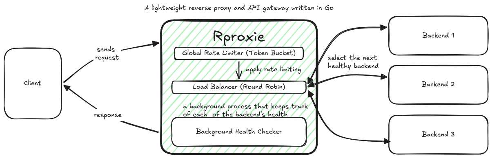

# rproxie

`rproxie` is a lightweight reverse proxy and API gateway written in Go. It forwards HTTP requests to configured backend servers, balances traffic across healthy backends, and can apply a process-wide token-bucket rate limit.

## Architecture



## Features

- Forwards request methods, paths, query strings, bodies, and headers to a backend, then relays the backend response.
- Selects backends with thread-safe round-robin balancing and skips backends marked unhealthy.
- Checks backend health at startup and every five seconds using `GET /health`; only HTTP 200 is considered healthy.
- Optionally limits requests with a shared token bucket. Rejected requests receive HTTP 429.
- Writes structured logs and shuts down gracefully on SIGINT or SIGTERM.

## Requirements

- Go 1.26.5 or later.
- One or more HTTP or HTTPS backends with a `GET /health` endpoint that returns HTTP 200.

## Configuration

The proxy reads YAML configuration. By default, it loads `./config_sample.yaml` from the current working directory. You can provide another file with `-config`:

```sh
go run ./cmd/rproxie -config ./path/to/config.yaml
```

Example configuration:

```yaml
server:
  port: 8000

backends:
  - id: backend-1
    url: http://localhost:9001
  - id: backend-2
    url: http://localhost:9002
  - id: backend-3
    url: http://localhost:9003

rate_limiter:
  enabled: true
  bucket_capacity: 10
  refill_rate_per_second: 2

logging:
  level: INFO
```

`server.port` must be between 1 and 65535. Configure at least one backend with an HTTP or HTTPS URL. Backend IDs are optional; omitted IDs are generated as `backend-1`, `backend-2`, and so on.

The `rate_limiter` section is required. Set `enabled` to `false` to allow requests without rate limiting. When enabled, `bucket_capacity` and `refill_rate_per_second` must both be positive. Each accepted request consumes one token; tokens refill at the configured rate up to the bucket capacity. The bucket is shared across all clients of the proxy process.

The `logging` section is optional and defaults to `INFO`. Supported levels are `DEBUG`, `INFO`, `WARN`, and `ERROR`.

## Run

From the project root, start the proxy with the sample configuration:

```sh
go run ./cmd/rproxie
```

The proxy listens on the configured port. Each backend is checked during startup and then every five seconds.

## Run with the included test backends

In one terminal, start three local test backends:

```sh
./scripts/run-test-backends.sh
```

The script builds the test backend and starts instances on ports 9001, 9002, and 9003. In another terminal, start the proxy with the sample configuration, then send a request:

```sh
go run ./cmd/rproxie
curl -i 'http://localhost:8000/example?hello=world'
```

The test backends return JSON identifying the backend and the method, path, and query string they received. The script stops the backends when it exits.

## Build

```sh
go build -o ./bin/rproxie ./cmd/rproxie
```

Run the binary from the project root to use the default config file, or pass a path explicitly:

```sh
./bin/rproxie
./bin/rproxie -config ./path/to/config.yaml
```

## Project layout

```text
cmd/
  rproxie/       Proxy application entry point
  testbackend/   Small HTTP backend for local development
internal/
  backend/       Backend URL and health state
  config/        YAML configuration loading and validation
  healthchecker/ Periodic backend health checks
  loadbalancer/  Round-robin backend selection
  logger/        Structured logger setup
  ratelimiter/   Optional token-bucket rate limiter
  rproxy/        Proxy lifecycle, request handling, and response forwarding
  utils/         JSON error responses and response cleanup
docs/
  rproxie_arch.png
scripts/
  run-test-backends.sh
```
